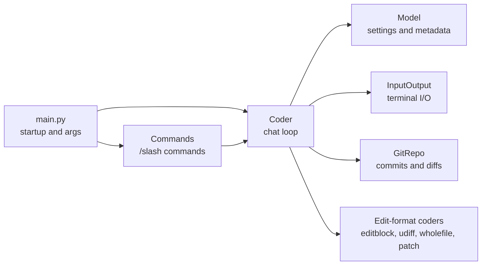

<div align="center">

# pairforge

**AI pair programming in your terminal.**
Edit code in your local git repository through a conversation with an LLM.

[](LICENSE.txt)
[](pyproject.toml)
[](https://github.com/imardagokce/pairforge/commits/main)
[](https://github.com/imardagokce/pairforge/stargazers)
[](https://github.com/imardagokce/pairforge/issues)
[](CONTRIBUTING.md)

[Features](#features) · [Quick start](#quick-start) · [Architecture](#architecture) · [Contributing](#contributing) · [Attribution](#attribution)

</div>

> [!NOTE]
> pairforge is a fork of [Aider-AI/aider](https://github.com/Aider-AI/aider) (Apache-2.0). It is an independent project and is **not** affiliated with or endorsed by the Aider maintainers. The command-line entry point is still `aider`. See [Attribution](#attribution).

---

## Features

| | |
| --- | --- |
| **Any LLM** | Cloud or local models: Claude, GPT, DeepSeek, Gemini, Ollama and more via [LiteLLM](https://github.com/BerriAI/litellm). |
| **Repo map** | Builds a map of your whole codebase so the model works well in larger projects. |
| **Git-native** | Auto-commits every change with a sensible message. Diff, review and undo AI edits with the git tools you already use. |
| **Multiple edit formats** | Edit-block, unified diff, whole-file and patch formats, selected per model. |
| **100+ languages** | Syntax-aware repo mapping through tree-sitter. |
| **Lint and test loop** | Runs your linters and tests after each change and can fix what they report. |
| **IDE friendly** | Ask for changes by adding comments to your code from any editor. |
| **Images and web pages** | Add screenshots and URLs to the chat as context. |
| **Voice-to-code** | Dictate requests and let the model implement them. |

## Quick start

pairforge requires Python 3.10 or newer.

```bash
# 1. Get the code
git clone https://github.com/imardagokce/pairforge.git
cd pairforge

# 2. Install in a virtual environment
python -m venv .venv
source .venv/bin/activate        # Windows: .venv\Scripts\activate
pip install -e .

# 3. Run it inside the project you want to edit
cd /path/to/your/project
export ANTHROPIC_API_KEY=<key>   # or OPENAI_API_KEY, DEEPSEEK_API_KEY, ...
aider --model sonnet
```

Run `aider --help` for every option. Model, provider and configuration details are covered in the [upstream documentation](https://aider.chat/docs/), which still applies to this codebase.

## Architecture



| Path | Role |
| --- | --- |
| `aider/main.py` | Argument parsing and startup |
| `aider/coders/` | `Coder` base class and the edit-format implementations |
| `aider/commands.py` | In-chat `/` commands |
| `aider/models.py` | Model definitions and settings |
| `aider/repo.py` | Git integration |
| `aider/io.py` | Terminal input and output |
| `tests/` | Test suite |
| `benchmark/` | Benchmark harness |

## Development

```bash
pip install -r requirements/requirements-dev.txt
pytest
```

## Contributing

Issues and pull requests are welcome. See the [roadmap](ROADMAP.md) for planned work. Please read [CONTRIBUTING.md](CONTRIBUTING.md) first.

## Attribution

pairforge is a modified version of [Aider](https://github.com/Aider-AI/aider), copyright Aider-AI contributors, used under the [Apache License 2.0](LICENSE.txt). Modifications are recorded in the git history, and the required notice is in [NOTICE](NOTICE). "Aider" is the name of the original project and is not claimed by pairforge. The original README is kept in [docs/UPSTREAM_README.md](docs/UPSTREAM_README.md).

## License

Licensed under the [Apache License 2.0](LICENSE.txt).
